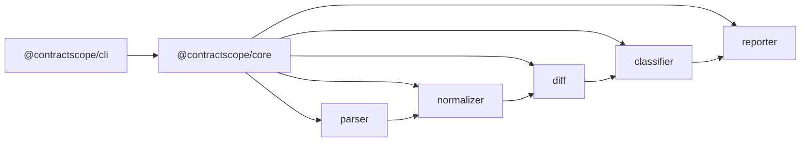

# ContractScope Architecture

## Overview

ContractScope separates reusable analysis logic from the CLI presentation layer.

## Package Responsibilities

### `@contractscope/core`

Domain library with no CLI dependencies:

| Module | Responsibility |
| --- | --- |
| `parser` | Load YAML/JSON, validate OpenAPI 3.0/3.1 basics, resolve local `$ref` |
| `normalizer` | Produce a stable `NormalizedContract` for comparison |
| `diff` | Detect structural differences between two normalized contracts |
| `classifier` | Map change types to `breaking` / `warning` / `non-breaking` |
| `reporter` | Format `AnalysisResult` as terminal text or JSON |
| `types` | Shared domain types and `ContractScopeError` |

### `@contractscope/cli`

Thin Commander-based interface:

- Resolve paths
- Call `analyzeFiles`
- Print or write reports
- Map results to process exit codes

## Data Flow

1. **Load** — read file bytes; parse YAML or JSON.
2. **Validate** — ensure `openapi`, `info`, and `paths` exist; accept 3.0.x / 3.1.x.
3. **Resolve** — expand local `#/...` references; reject remote refs; detect cycles.
4. **Normalize** — extract paths, operations, parameters, request bodies, response schemas.
5. **Diff** — compare normalized graphs deterministically.
6. **Classify** — assign severities with request vs response awareness.
7. **Report** — emit terminal or JSON output.

## Parser Architecture

- `load.ts` — filesystem + YAML/JSON parsing
- `validate.ts` — Zod-based structural validation
- `json-pointer.ts` — RFC 6901 token encode/decode
- `ref-resolver.ts` — local `$ref` resolution with cycle detection
- Public entry: `parseContractFile` / `parseContractDocument` / `parseContractText`

Remote `$ref` fetching is intentionally unsupported.

## Normalization Process

Normalization produces sorted, comparison-ready structures:

- Path keys and HTTP methods are enumerated in stable order.
- Parameters keyed by `in:name`.
- Schemas retain `type`, `properties`, `required`, `items`, `enum`, `nullable`, `additionalProperties`.
- Unsupported keywords (`allOf`, `oneOf`, `anyOf`, `discriminator`, …) are recorded on `unsupportedFeatures` rather than silently dropped without notice.

## Diff Strategy

- Endpoint added/removed
- Operation added/removed per HTTP method
- Parameter add/remove/required/type
- Request body required flag and object property changes
- Response status add/remove and object property/type changes

Results are sorted by path → method → type → description, then assigned stable IDs.

## Classification Strategy

| Change | Severity |
| --- | --- |
| Removed endpoint / operation | breaking |
| Added endpoint / operation | non-breaking |
| New required request parameter / property | breaking |
| Optional → required request parameter | breaking |
| Removed required request parameter | non-breaking |
| Removed documented response property | breaking |
| Response property type change | breaking |
| New optional/required response property | non-breaking |
| Unsupported / indeterminate schema constructs | warning |

Request compatibility (client → server) and response compatibility (server → client) are evaluated with different assumptions.

## Error Handling

Errors use `ContractScopeError` with codes:

- `PARSE_ERROR` — I/O or YAML/JSON parse failures
- `VALIDATION_ERROR` — invalid OpenAPI structure / version
- `REF_ERROR` — unresolved, remote, or circular references

The CLI prints the code and message and exits with code `2`.

## Major Technical Trade-offs

1. **Local refs only** — avoids network and security complexity; limits multi-file specs.
2. **Conservative unsupported schema handling** — emit warnings instead of guessing.
3. **Object-property focused schema diff** — covers the MVP rules without a full JSON Schema lattice.
4. **Monorepo core + cli** — keeps the library independently reusable.

## Future Extension Points

- Pluggable classifiers for organization-specific compatibility policies
- Multi-document / remote `$ref` resolver with caching
- Deeper JSON Schema compatibility (composition keywords)
- Frontend TypeScript AST impact analysis consuming `AnalysisResult`
- CI reporters (GitHub Annotations, SARIF)

These are not implemented in the current MVP.
